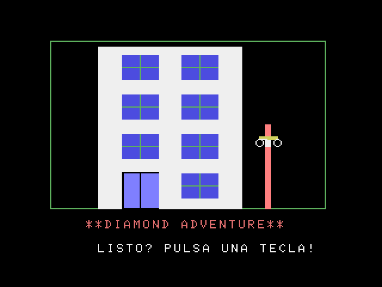
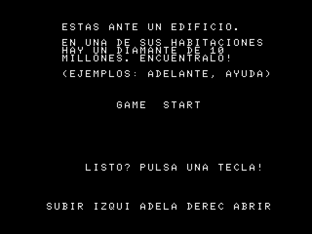
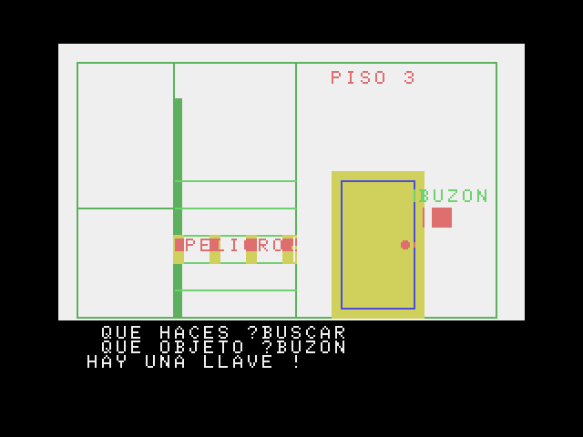
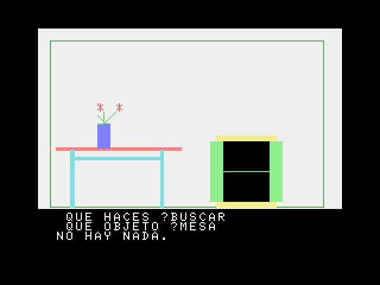

# Diamond Adventure en castellano (MSX)

Traducción completa al castellano de **Diamond Adventure** (Micro Cabin, 1983), una aventura conversacional japonesa para MSX escrita en MSX-BASIC. Están traducidos todos los textos y también el analizador de órdenes, así que el juego entiende verbos y objetos en castellano.

El repositorio **no incluye el juego**: solo el parche IPS que convierte la cinta japonesa original en la versión en castellano, con instrucciones para aplicarlo.

## Capturas

Versión traducida (v1.0) en openMSX, con un Sony HB-20P (MSX europeo).

| | |
|---|---|
|  |  |
| Pantalla de título | Introducción |
|  |  |
| Piso 3: `BUSCAR` `BUZON` | Habitación A: `BUSCAR` `MESA` |

## Qué necesitas

La cinta original en formato CAS, exactamente esta:

| | Valor |
| --- | --- |
| Nombre habitual | `Diamond Adventure (1983)(MicroCabin)(JP)[!][CLOAD].cas` |
| Tamaño | 11 427 bytes |
| CRC32 | `5DDE523D` |
| MD5 | `545804b78ff49c713b4ba799c0a3e90c` |
| SHA-1 | `40d09fbbad5d5afe1c9baa4bd8c3efd08bb37b1c` |

El parche es [`releases/DiamondAdventure_ES_v1.0.ips`](releases/DiamondAdventure_ES_v1.0.ips), también disponible en la página de la release v1.0.

## Cómo aplicar el parche

Elige una de estas formas:

- **En el navegador:** abre [Rom Patcher JS](https://www.marcrobledo.com/RomPatcher.js/), elige el CAS original como «ROM file» y el `.ips` como «Patch file», y pulsa «Apply patch».
- **Con Floating IPS o Lunar IPS** (Windows): «Apply Patch», elige el `.ips` y después el CAS original. Trabaja sobre una copia, porque Lunar IPS modifica el fichero elegido.
- **Con Python 3**, usando la herramienta del repositorio, que además comprueba que el original y el resultado son los correctos:

  ```sh
  python3 tools/aplica_ips.py "Diamond Adventure (1983)(MicroCabin)(JP)[!][CLOAD].cas" \
      releases/DiamondAdventure_ES_v1.0.ips DIAMANTE_ES.cas \
      --sha1-orig 40d09fbbad5d5afe1c9baa4bd8c3efd08bb37b1c \
      --sha1-dest 3406183951e717e5c66e1c4098c737a7ef4d60eb
  ```

El resultado debe ser este:

| | Valor |
| --- | --- |
| Tamaño | 11 824 bytes |
| CRC32 | `9B4320D7` |
| MD5 | `0b71d3b725fc6c47e164f41d161ffaa0` |
| SHA-1 | `3406183951e717e5c66e1c4098c737a7ef4d60eb` |

## Cómo jugar

Carga el CAS en un MSX (o en openMSX) con `CLOAD` y luego `RUN`. El programa se llama `Adv`. Funciona en MSX japonés y europeo: los textos están en mayúsculas y sin tildes ni Ñ para que se vean bien con los dos juegos de caracteres.

El juego pregunta primero **QUE HACES ?** (el verbo) y, si hace falta, **QUE OBJETO ?**. Basta con escribir las tres primeras letras de cada palabra; da igual mayúsculas o minúsculas.

- **Verbos:** AYUDA, MOVER, COGER, MIRAR, SUBIR, BAJAR, DERECHA, IZQUIERDA, ADELANTE, ABRIR, USAR, ENCENDER, ATRAS, BUSCAR, CONECTAR, APAGAR, ENTRAR, FIN.
- **Objetos:** PUERTA, BUZON, LLAVE, SILLA, MESA, ARMARIO, LIBRO, JARRON, TELE, DIAMANTE, VENTANA, CAJA, VELA, CERILLAS, CUADRO, BOLIGRAFO, NOTA.
- **Teclas de función:** F1 SUBIR, F2 IZQUIERDA, F3 ADELANTE, F4 DERECHA, F5 ABRIR, F6 ATRAS, F7 BAJAR, F8 COGER, F9 BUSCAR, F10 AYUDA.

Cuidado: **FIN** borra el programa de la memoria (hace `NEW`), igual que en el original.

Si te atascas, la solución completa está en [`docs/SOLUCION.md`](docs/SOLUCION.md). Cómo funciona el juego y qué se ha cambiado está en [`docs/NOTAS_TECNICAS.md`](docs/NOTAS_TECNICAS.md).

## Qué hay en el repositorio

- `releases/DiamondAdventure_ES_v1.0.ips`: el parche.
- `tools/aplica_ips.py`: aplica un IPS y comprueba los SHA-1.
- `tools/crea_ips.py`: crea el IPS a partir del original y la traducción.
- `docs/`: solución y notas técnicas.

**No se incluyen ni la cinta original ni la traducida.**

## Pruebas

- Partida completa ganada con un intérprete de MSX-BASIC propio y un jugador automático. La misma partida con el original japonés, tecleando en katakana, sigue exactamente el mismo camino (63 467 pasos iguales).
- Partida completa terminada por araubi.

## Créditos

- Juego original: *Diamond Adventure*, Micro Cabin, 1983.
- Traducción, dirección y pruebas: araubi.
- Análisis, herramientas y documentación: desarrollados con Claude (Anthropic).

## Licencia y avisos

- **Herramientas** (`tools/`): [MIT](LICENSE).
- **Documentación** (`docs/` y este README): [CC BY-NC-SA 4.0](LICENSE-CC).
- **Juego original y parche de `releases/`:** *Diamond Adventure* es obra de Micro Cabin (1983) y sus derechos son de sus titulares. El parche contiene partes del programa original modificado y no está cubierto por ninguna de las licencias anteriores. Esta traducción es un homenaje sin ánimo de lucro: no se reclama ningún derecho sobre el original, y el parche se retirará si los titulares lo piden.
